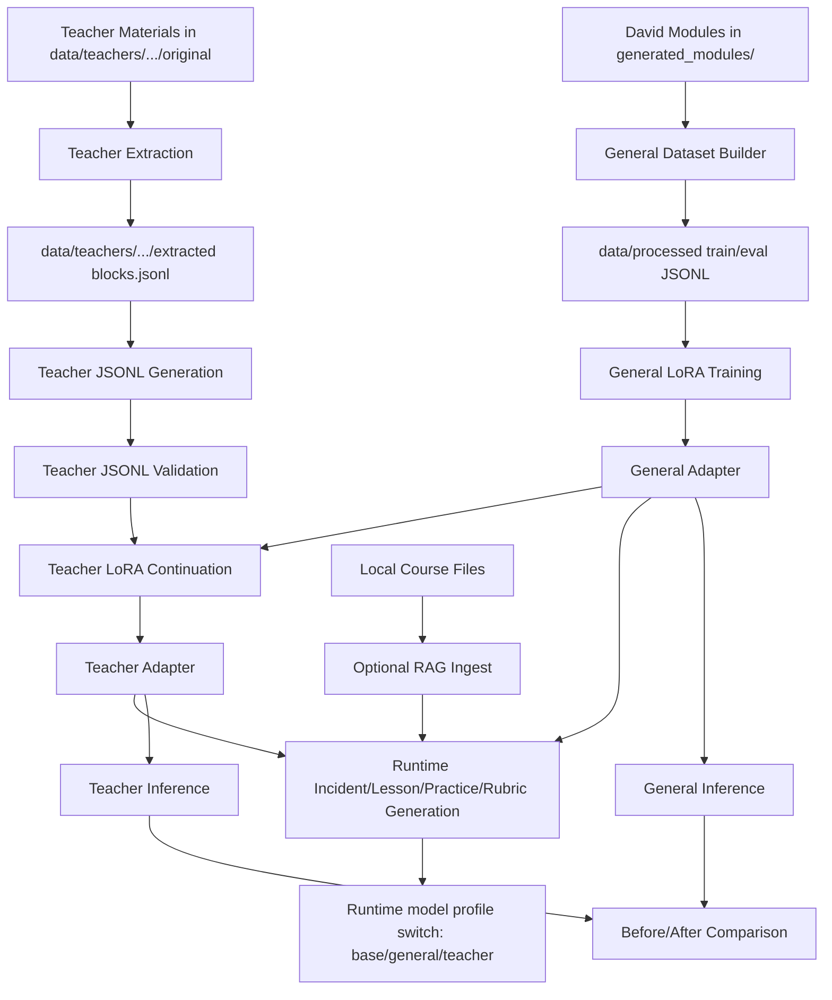

# Local Cybersecurity Education Pipeline

This project supports local, privacy-preserving cybersecurity education
workflows with two training stages:

1. A `general` adapter trained on David's fixed-format cybersecurity modules.
2. A `teacher` adapter trained on instructor-provided course materials so the
   model can generate security content that fits a specific CS course context.

The current repository uses:
- David's module corpus in `generated_modules/21 Modules/**/security_*_document.md`
- a database-course teacher corpus based on `SQL-101` in
  `data/teachers/sql101/original/`
- additional teacher materials can be placed under `data/teachers/`

## Branch Notes

- `server/8b`
  - server-oriented profile for running the 8B Granite-based workflow on a GPU
    node
  - intended for heavier training and inference runs when local hardware is not
    sufficient
- `local/2b`
  - local 2B Granite workflow intended for lighter-weight pipeline checks on a
    desktop GPU
  - keeps the core training and runtime path available in a smaller setup

This repository is built for a specific teaching problem: an instructor may
want cybersecurity content that is both domain-aware and course-aware, while
keeping all data, adaptation, and evaluation local and inspectable.

Design goal: build a reusable general cybersecurity education model from
David's stable module format first, then allow a teacher to adapt that model
with course materials from a concrete CS course. The output target is not a
new David-style module set, but cybersecurity learning materials that match a
course context.

Motivation: David's modules act as the general cybersecurity knowledge source,
while teacher materials act as the course customization source. This avoids a
black-box workflow where it is unclear where domain knowledge comes from, how
training data was derived, or why the generated output fits a specific class.

Feature significance: the current design keeps each layer explicit. LoRA/SFT
provide a traceable way to adapt the model, CAG supplies runtime style and
example guidance, RAG injects local supporting context, and the split between
general training and teacher customization makes it easier to inspect,
compare, and refine each stage independently.

## System Overview

The project has three main layers, in execution order:

1. General adapter training
   - builds supervised JSONL from David's module corpus
   - trains a LoRA adapter that captures general cybersecurity teaching
     knowledge
2. Teacher customization
   - ingests teacher-provided course materials without modifying the originals
   - extracts text blocks
   - generates teacher-stage JSONL
   - continues training from the general adapter to produce a customized
     teacher adapter
3. Runtime generation
   - loads one of three runtime model profiles: `base`, `general`, or
     `teacher`
   - generates incident briefings, lesson explanations, practice activities,
     and rubrics
   - can add optional RAG over locally indexed content
   - runs a verifier and writes report/trace artifacts for auditability

## Core Roles

These terms refer to different layers of the system and should not be treated
as interchangeable:

- `base model`
  - the underlying local Granite instruct model from
    `models/granite-3.3-8b-instruct`
- `adapter`
  - LoRA weights trained on top of the base model
  - `general adapter` captures broad cybersecurity teaching style
  - `teacher adapter` adds course-specific framing such as SQL-class language
- `general model`
  - the base model with the general adapter loaded at inference time
- `teacher-customized model`
  - the base model with the teacher adapter loaded at inference time
  - in this repository, that teacher adapter was produced by continuing from
    the general adapter during training
- `orchestrator`
  - the runtime controller in `runtime/workflow/orchestrator.py`
  - it does not train or store model weights
  - it receives CLI tasks, selects the model profile, optionally retrieves RAG
    context, assembles CAG + RAG prompts, calls generation, runs the verifier,
    and writes run artifacts
- `CLI subcommands`
  - `ingest`, `incident`, `lesson`, `practice`, and `rubric` are project-level
    commands defined in `runtime/app/cli.py`
  - they organize user requests into task-specific runtime workflows rather
    than acting as training steps
- `CAG`
  - adds fixed style guidance and examples to runtime prompts
- `RAG`
  - retrieves local chunks first, then inserts them into the prompt before
    generation

In short:
- the model and adapter determine what the system has learned
- CAG determines how it should write
- RAG determines what local context it should reference for this run
- the CLI and orchestrator determine what kind of output is being requested

Training vs inference relationship:

```text
Training stage
base model
  -> train on David modules
  -> general adapter
  -> continue training on teacher materials
  -> teacher adapter

Inference stage
base model + general adapter = general model behavior
base model + teacher adapter = teacher-customized model behavior
```

Important note:
The teacher adapter is trained by continuing from the general-model path, so
the training dependency is `base -> general -> teacher`. However, the saved
teacher adapter is the final teacher-stage adapter, so runtime inference loads
it directly on top of the base model rather than stacking both the general and
teacher adapters at the same time.

## Pipeline Flowchart



Current workflow:
- `training/data_build/build_from_modules.py` converts David's incident,
  lesson, and practice documents into general-stage JSONL.
- `training/train_lora.py` trains the general adapter and then the
  teacher-continuation adapter.
- `training/data_build/extract_teacher_corpus.py`,
  `generate_teacher_jsonl.py`, and `validate_teacher_jsonl.py` prepare the
  teacher-stage dataset.
- `training/infer_with_adapter.py` is the direct adapter test path.
- `runtime/app/cli.py` is the terminal entry point for runtime generation.
- `runtime/workflow/orchestrator.py` is the runtime controller for model
  selection, CAG, RAG, verification, and trace/report logging.

## Repository Structure

- `generated_modules/`
  - David's generated cybersecurity modules
  - input corpus for the general training stage
- `data/processed/`
  - general-stage train/eval JSONL built from `generated_modules/`
- `data/teachers/sql101/original/`
  - imported teacher materials kept in original form
- `data/teachers/sql101/extracted/`
  - normalized text blocks extracted from teacher materials
- `data/teachers/sql101/processed/`
  - teacher-stage train/eval JSONL
- `data/eval/`
  - evaluation and benchmark data
- `runtime/`
  - runtime CLI, RAG, CAG, workflow, verifier
- `training/`
  - LoRA training, inference, and data-build scripts
- `runs/`
  - runtime, training, and comparison artifacts

## David Modules

David's modules are the source corpus for the general cybersecurity education
model. The repository assumes new modules will continue to follow the same or a
very similar structure.

Important format assumptions:
- modules live under `generated_modules/21 Modules/module_*/`
- each module provides:
  - `security_incident_document.md`
  - `security_lesson_document.md`
  - `security_practice_document.md`
- the corpus mixes real-vulnerability context, lesson-style explanations, and
  practice-oriented educational content in these three document types

Items that need attention when using new modules:
- keep the `module_*` directory convention stable
- keep the three `security_*_document.md` files present for each module
- preserve front matter and `##` section headings because the current builder
  uses those structures to create training samples
- avoid adding archive artifacts such as `__MACOSX/` into the training source
- review especially long or code-heavy practice sections because they can
  dominate supervision text if left unchecked

How the fine-tuned general model reflects module content:
- the general dataset builder turns incident, lesson, and practice sections
  into training-ready `messages`
- the resulting adapter learns cybersecurity teaching language such as
  incident briefings, lesson-style explanations, and practice-oriented task
  formats
- the model output remains broad and cybersecurity-centered, which is useful for
  general instruction but not sufficient by itself for course-specific teaching

## Environment Setup

Create a virtual environment and install dependencies:

```bash
python -m venv .venv
source .venv/bin/activate
pip install -r requirements.txt
srun -p gpu-preempt      --gres=gpu:a100:1      --cpus-per-task=8      --mem=64G      -t 2:00:00      --pty bash
```

Download the base model locally:

```bash
huggingface-cli download ibm-granite/granite-3.3-8b-instruct \
  --local-dir models/granite-3.3-8b-instruct
```

Confirm `configs/config.yaml` points to the local model directory:

```yaml
model:
  base_model_dir: "models/granite-3.3-8b-instruct"
```

## Quick Start

The shortest end-to-end path is:

1. Build the general-stage JSONL from David's modules.
2. Train the general adapter.
3. Extract and generate the teacher-stage JSONL.
4. Train the teacher adapter from the general adapter.
5. Build RAG collections.
6. Run runtime generation with the `teacher` profile.

```bash
cd /home/yrong_umassd_edu/project_edu/edu-proj
source .venv/bin/activate

python -m training.data_build.build_from_modules \
  --source-dir "generated_modules/21 Modules" \
  --train-out data/processed/train.jsonl \
  --eval-out data/processed/eval.jsonl

python training/train_lora.py \
  --mode general \
  --config configs/config.yaml

python -m training.data_build.extract_teacher_corpus \
  --source-dir data/teachers/sql101/original \
  --course-id sql101 \
  --out data/teachers/sql101/extracted/blocks.jsonl

python -m training.data_build.generate_teacher_jsonl \
  --extracted-file data/teachers/sql101/extracted/blocks.jsonl \
  --train-out data/teachers/sql101/processed/train.jsonl \
  --eval-out data/teachers/sql101/processed/eval.jsonl \
  --model-path models/granite-3.3-8b-instruct

python -m training.data_build.validate_teacher_jsonl \
  --train-file data/teachers/sql101/processed/train.jsonl \
  --eval-file data/teachers/sql101/processed/eval.jsonl

python training/train_lora.py \
  --mode teacher \
  --config configs/config.yaml \
  --init-adapter runs/<general_run_id>/adapter \
  --train-file data/teachers/sql101/processed/train.jsonl \
  --eval-file data/teachers/sql101/processed/eval.jsonl

python -m runtime.app.cli ingest \
  --collection general \
  --source-glob "generated_modules/21 Modules/**/*.md"

python -m runtime.app.cli ingest \
  --collection teacher \
  --source-glob "data/teachers/sql101/original/**/*.md"

python -m runtime.app.cli lesson \
  --model-profile teacher \
  "Teach SQL injection prevention in a database course context."

python -m runtime.app.cli practice \
  --model-profile teacher \
  "Create a beginner SQL security practice activity about parameterized queries."

python -m runtime.app.cli rubric \
  --model-profile teacher \
  "Focus on correctness, clarity, and defensive reasoning."
```

## Runtime Workflow

Runtime is downstream from training. Once the base model and any desired
adapter are available, the CLI can run in one of three model profiles:

- `base`
  - base model only
- `general`
  - base model plus the general adapter
- `teacher`
  - base model plus the teacher adapter

Current default:
- `teacher`

The runtime orchestrator uses the selected profile for generation, while the
verifier stays on the `base` profile by default. These mappings are configured
in `configs/config.yaml`.

Build the local RAG index for the general collection:

```bash
python -m runtime.app.cli ingest --collection general --source-glob "generated_modules/21 Modules/**/*.md"
```

Build the teacher collection:

```bash
python -m runtime.app.cli ingest --collection teacher --source-glob "data/teachers/sql101/original/**/*.md"
python -m runtime.app.cli ingest --collection teacher --source-file "<path/to/course_material.md>"
```

Run the CLI:

```bash
python -m runtime.app.cli incident "Create an incident briefing about insecure patch validation"
python -m runtime.app.cli lesson --model-profile base "Teach secure input validation to beginners"
python -m runtime.app.cli lesson --model-profile general "Teach secure input validation to beginners"
python -m runtime.app.cli practice --model-profile teacher "Create a beginner SQL security practice activity"
python -m runtime.app.cli rubric --model-profile teacher "Focus on clarity and correctness"
```

Runtime artifacts are written under:
- `runs/<run_id>/report.md`
- `runs/<run_id>/trace.jsonl`

Each runtime report now records:
- generator model profile
- generator adapter path
- verifier model profile
- verifier adapter path

Runtime request flow:

```text
CLI command
  -> task selection (incident / lesson / practice / rubric)
  -> orchestrator
  -> optional RAG retrieval from local Chroma index
  -> CAG prompt assembly (style guide + example + task instruction)
  -> selected runtime model profile (base / general / teacher)
  -> verifier check
  -> report and trace artifacts in runs/
```

In this flow, the task type determines what kind of content is requested, the
selected model profile determines which trained model behavior is used, CAG
adds style and example guidance, and RAG adds retrieved local context when
enabled. The runtime uses separate RAG collections for general and teacher
materials. In the current design, the `teacher` model profile retrieves from
the teacher collection first and then falls back to the general collection if
it needs additional context.

## Stage 1: General Adapter Training

This stage creates the general cybersecurity education model from David's
modules before any teacher-specific customization is applied.

Build train/eval JSONL from David's module corpus:

```bash
python -m training.data_build.build_from_modules \
  --source-dir "generated_modules/21 Modules" \
  --train-out data/processed/train.jsonl \
  --eval-out data/processed/eval.jsonl
```

Train the general adapter:

```bash
python training/train_lora.py \
  --mode general \
  --config configs/config.yaml
```

Current general-stage reference run:
- `runs/20260227_194005_general_train/`

Additional notes:
- the module format is treated as stable
- the builder is designed for David's corpus rather than arbitrary user input

General-model generation pipeline summary:
1. collect David's modules in `generated_modules/21 Modules/`
2. transform them into `data/processed/train.jsonl` and `eval.jsonl`
3. train the general adapter
4. use the general adapter as the base for any later teacher-specific adapter

## Stage 2: Teacher Customization

Teacher customization keeps raw course materials unchanged and uses a
four-layer pipeline:

1. `original/`
2. `extracted/`
3. `processed/`
4. `validated`

### Teacher Corpus

The current teacher experiment uses a database-course corpus based on
`SQL-101`, stored under:

- `data/teachers/sql101/original/`

### Extract Teacher Materials

```bash
python -m training.data_build.extract_teacher_corpus \
  --source-dir data/teachers/sql101/original \
  --course-id sql101 \
  --out data/teachers/sql101/extracted/blocks.jsonl
```

### Generate Teacher JSONL

Teacher JSONL is generated from extracted text blocks with the base model:

```bash
python -m training.data_build.generate_teacher_jsonl \
  --extracted-file data/teachers/sql101/extracted/blocks.jsonl \
  --train-out data/teachers/sql101/processed/train.jsonl \
  --eval-out data/teachers/sql101/processed/eval.jsonl \
  --model-path models/granite-3.3-8b-instruct
```

Validate the generated JSONL:

```bash
python -m training.data_build.validate_teacher_jsonl \
  --train-file data/teachers/sql101/processed/train.jsonl \
  --eval-file data/teachers/sql101/processed/eval.jsonl
```

Current generated teacher dataset size:
- `105` train examples
- `18` eval examples

### Train the Teacher Adapter

Continue training from the general adapter:

```bash
python training/train_lora.py \
  --mode teacher \
  --config configs/config.yaml \
  --init-adapter runs/20260227_194005_general_train/adapter \
  --train-file data/teachers/sql101/processed/train.jsonl \
  --eval-file data/teachers/sql101/processed/eval.jsonl
```

Current teacher-stage reference run:
- `runs/20260305_120655_teacher_train/`

## Inference

Run inference with any adapter:

```bash
python training/infer_with_adapter.py \
  --adapter runs/<run_id>/adapter \
  --prompt "Create one cybersecurity scenario question" \
  --out runs/<run_id>/inference/scenario.md \
  --save_prompt
```

## Teacher Experiment

The current teacher experiment uses:
- course: introductory database / SQL
- teacher corpus: `SQL-101`
- selected lecture topic: querying data
- security focus: SQL injection prevention

The goal is to make the customized adapter generate cybersecurity learning
materials that better match the structure, terminology, and teaching context
of the selected course. In this case, the teacher-stage model should reflect
database-course language such as `SELECT`, filtering, parameterized queries,
joins, and transaction concepts, while also producing course-aligned outputs
such as lecture notes, topic explanations, and classroom practice questions
for a database lecture with a security focus.

In model-role terms:
- the `teacher-customized model` is the trained model behavior produced by the
  teacher continuation stage
- the runtime `orchestrator` is the application layer that can now select that
  teacher model through the `teacher` runtime profile
- supporting three runtime profiles makes it possible to compare `base`,
  `general`, and `teacher` behavior without changing code

## Case Study

This repository includes a complete showcase based on an introductory database
course scenario.

Role assumption:
- assume the user is the instructor of an introductory SQL / database course


Targeted lecture:
- source materials:
  - https://github.com/s-shemmee/SQL-101/blob/main/README.md
- selected lecture topic:
  - `Querying Data`
- security-focused customization target:
  - `SQL Injection Prevention in Querying Data`

Why this lecture was selected:
- it is a natural place to add secure query construction and SQL injection
  prevention
- it allows comparison between general cybersecurity knowledge and
  course-specific database framing

Case-study pipeline:
1. import teacher course materials into `data/teachers/sql101/original/`
2. extract normalized text blocks into `data/teachers/sql101/extracted/`
3. generate teacher-stage JSONL into `data/teachers/sql101/processed/`
4. continue training from the general adapter
5. select the runtime model profile or direct inference target: `base`,
   `general`, or `teacher`
6. run the same course-aligned prompt against the general and teacher adapters
7. compare structure, terminology, and instructional usefulness

This case study is intended as a concrete showcase of how the pipeline works
end-to-end, even though output quality can still be improved in later
iterations.

## Before/After Comparison

Comparison prompt:

```text
Write a classroom handout for an introductory database lecture on querying data.

Security focus: SQL injection prevention.

Requirements:
- Output only the final handout.
- Do not write a conversation.
- Do not include role labels such as user, assistant, or system.
- Keep the material aligned to a database course, not a general cybersecurity lecture.
- Use clear beginner-friendly language.
- Emphasize defensive security practices only.

Use exactly these sections:
1. Overview
2. Querying Data Concepts
3. Security Connection
4. One Example
5. One Practice Question
```

Reference outputs:
- general adapter:
  - `runs/general_before_teacher.md`
- teacher adapter:
  - `runs/20260305_120655_teacher_train/inference/sql101_after_teacher.md`

Observed result summary:
- The general adapter preserved cybersecurity framing, but it stayed broad and
  repetitive, and it did not strongly align to the structure of a database
  lecture.
- The teacher adapter followed the requested numbered handout structure more
  closely and included more explicit SQL-class language such as `SELECT`,
  parameterized queries, and classroom practice framing.
- The teacher adapter also showed a quality issue: it overgenerated extra
  assessment-style content after the requested sections, which suggests that the
  teacher-stage data improved course alignment but still needs tighter output
  control.

This comparison supports the main experimental claim:
- teacher-stage continuation can make the model more course-aware
- but the current customization pipeline still needs tighter generation control
  to avoid format drift

## Testing Runtime Profile Switching

1. Confirm the configured adapter paths exist:

```bash
ls runs/20260227_194005_general_train/adapter
ls runs/20260305_120655_teacher_train/adapter
```

2. Run the same prompt through all three profiles:

```bash
python -m runtime.app.cli practice --model-profile base "Write a short SQL security classroom practice activity."
python -m runtime.app.cli practice --model-profile general "Write a short SQL security classroom practice activity."
python -m runtime.app.cli practice --model-profile teacher "Write a short SQL security classroom practice activity."
```

3. Check the console output:
- `model_profile=base`
- `model_profile=general`
- `model_profile=teacher`

4. Open the newest runtime report under `runs/<run_id>/report.md` and confirm:
- `generator_model_profile` matches the selected profile
- `generator_adapter_path` is `none` for `base`
- `generator_adapter_path` points to the general adapter for `general`
- `generator_adapter_path` points to the teacher adapter for `teacher`

5. Compare output behavior:
- `base` should sound like the original Granite instruct model
- `general` should show broader cybersecurity teaching style
- `teacher` should align more strongly with the SQL-course framing

6. Test incident, lesson, and rubric generation the same way if needed:

```bash
python -m runtime.app.cli incident --model-profile teacher "Create a defensive incident briefing about query injection risk."
python -m runtime.app.cli lesson --model-profile teacher "Teach what a parameterized query is."
python -m runtime.app.cli rubric --model-profile teacher "Focus on beginner-friendly grading language"
```

## Difference from the Reference Paper

The reference paper appears to use an SLM-based teaching workflow, but it does
not describe a public fine-tuning pipeline with LoRA or a released
implementation. Because the system is not open-sourced, its detailed internal
design is not fully visible from the outside.

This repository takes a different and more explicit design path:

- it does not stop at using an SLM only for runtime generation
- it builds a general cybersecurity education model first from David's module
  corpus
- it then builds a teacher-specific model on top of that general model instead
  of adapting each teacher directly from scratch
- it uses a separate teacher pipeline in which original teacher materials are
  extracted, converted into teacher-stage JSONL, and then used for continued
  fine-tuning
- it makes the training stages and intermediate artifacts visible in the
  repository, so the workflow can be inspected and reproduced

The practical rationale is that a teacher model should inherit a stable
cybersecurity foundation before it learns course-specific teaching context. In
this design, David's modules provide the shared cybersecurity base, while the
teacher materials provide the course framing and instructional language. That
gives the customized model a more unified starting point than a design that
only applies an SLM to teacher materials without an explicit general
fine-tuning stage.

## Supporting Documents

- `docs/data_pipeline.md`
  - general-stage data transformation notes
- `docs/model_training_pipeline.md`
  - general-to-teacher training workflow
- `docs/teacher_pipeline.md`
  - teacher-material extraction and JSONL generation pipeline

## Artifact Notes

Local-heavy artifact folders are treated as outputs rather than source:
- `models/`
- `chroma/`
- `runs/`

Selected run artifacts are kept in this repository for reference and comparison.
