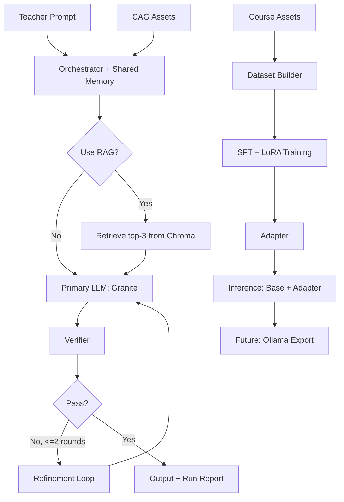

# Local Cybersecurity Education Pipeline (Granite + LoRA)

**Branch note**
- `main`: local development profile (2B)
- `server/8b`: server profile (8B)

This project is designed for **local, privacy-preserving cybersecurity education content creation and assessment support**. It provides a runnable pipeline for exercise/rubric/factual generation plus adapter fine-tuning.

## What This Tool Enables
- `CAG` asset grounding from local course files.
- Optional `RAG` retrieval from local Chroma (`top-3` by default).
- Orchestrator with shared run memory and trace/report outputs.
- Teacher-facing refinement loop (up to 2 rounds).
- Verifier gate before final output.
- `SFT + LoRA` adapter training from local JSONL data.
- Inference with `base model + adapter`.
- Ollama export placeholder (`training/export_ollama/README.md`).

## Pipeline Flowchart


## Server Usage Guide (8B / H100)

### 1) Clone the repo
```bash
git clone <your_repo_url>
cd edu-proj
```

### 2) Create virtual environment and install requirements
```bash
python -m venv .venv
source .venv/bin/activate
pip install -r requirements.txt
```

### 3) Download base model to local directory
Hugging Face model reference (plain text): `ibm-granite/granite-3.3-8b-instruct`

```bash
huggingface-cli download ibm-granite/granite-3.3-8b-instruct \
  --local-dir models/granite-3.3-8b-instruct
```

### 4) Update config
Edit `configs/config.yaml` and confirm:
```yaml
model:
  base_model_dir: "models/granite-3.3-8b-instruct"
```

### 5) Generate mock training data
```bash
python training/data_build/make_mock_data.py
```

### 6) Build local RAG index (ingest)
```bash
python -m runtime.app.cli ingest
```

### 7) Run runtime CLI demo
Exercise:
```bash
python -m runtime.app.cli exercise "Create a beginner phishing quiz"
```

Rubric:
```bash
python -m runtime.app.cli rubric "Focus on clarity and correctness"
# or
python -m runtime.app.cli rubric --exercise-text "<paste exercise text>"
```

Factual:
```bash
python -m runtime.app.cli factual "What is least privilege?"
```

### 8) Run LoRA training
Dry-run (config + model load check only):
```bash
python training/train_lora.py --dry-run
```

Full run:
```bash
python training/train_lora.py --config configs/config.yaml
```

### 9) Run inference with adapter and save output
```bash
python training/infer_with_adapter.py \
  --adapter runs/<run_id>/adapter \
  --prompt "Create one cybersecurity scenario question" \
  --out runs/<run_id>/inference/scenario.md \
  --save_prompt
```

### 10) Output locations
Artifacts are written under:
- `runs/<run_id>/report.md`
- `runs/<run_id>/trace.jsonl`
- `runs/<run_id>/adapter/`
- `runs/<run_id>/inference/...`

## Repository Artifact Tracking Notes
By default, local-heavy artifact folders are treated as non-source outputs:
- `models/`, `data/`, and `chroma/` are ignored by `.gitignore`.
- `runs/` should also be treated as generated runtime/training output; this branch may still include selected run artifacts for reference.
