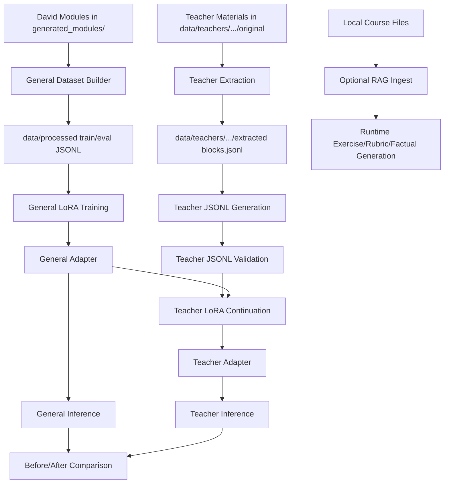

# Local Cybersecurity Education Pipeline

This project supports local, privacy-preserving cybersecurity education
workflows with two training stages:

1. A `general` adapter trained on David's fixed-format cybersecurity modules.
2. A `teacher` adapter trained on instructor-provided course materials so the
   model can generate security content that fits a specific CS course context.

The current repository uses:
- David's module corpus in `generated_modules/`
- a database-course teacher corpus based on `SQL-101` in
  `data/teachers/sql101/original/`

## Branch Notes

This repository is organized around a local-first workflow rather than a
cloud-hosted product workflow.

- `main`
  - active development branch for the full end-to-end education pipeline
  - contains the current general-training, teacher-customization, runtime, and
    experiment artifacts used in this project report
- `server/8b`
  - server-oriented profile for running the 8B Granite-based workflow on a GPU
    node
  - intended for heavier training and inference runs when local hardware is not
    sufficient

The tool is designed to solve a specific teaching problem: instructors may want
cybersecurity content that is both domain-aware and course-aware, while still
keeping all data and model adaptation local. The motivation is to avoid a
single black-box generator that cannot easily show where domain knowledge came
from, how training data was derived, or how the output was adapted to a
particular course. The enabled features are meaningful because they separate
the broad cybersecurity knowledge stage from the teacher-specific adaptation
stage, making the workflow more auditable, reusable, and extensible.

## System Overview

The project has three main layers:

1. Runtime generation
   - local generation for exercises, rubrics, and factual answers
   - optional RAG over locally indexed content
   - verifier and run traces for auditability
2. General adapter training
   - builds supervised JSONL from David's module corpus
   - trains a LoRA adapter that captures general cybersecurity teaching
     knowledge
3. Teacher customization
   - ingests teacher-provided course materials without modifying the originals
   - extracts text blocks
   - generates teacher-stage JSONL（SLM）
   - continues training from the general adapter to produce a customized
     teacher adapter

## Pipeline Flowchart



## Repository Structure

- `generated_modules/`
  - David's generated cybersecurity modules
  - input corpus for the general training stage
- `data/processed/`
  - general-stage train/eval JSONL built from `generated_modules/`
- `data/teachers/sql101/original/`
  - imported teacher materials kept in original form
- `data/teachers/sql101/extracted/`
  - normalized text blocks extracted from teacher materials
- `data/teachers/sql101/processed/`
  - teacher-stage train/eval JSONL
- `data/eval/`
  - evaluation and benchmark data
- `runtime/`
  - runtime CLI, RAG, CAG, workflow, verifier
- `training/`
  - LoRA training, inference, and data-build scripts
- `runs/`
  - runtime, training, and comparison artifacts

## David Modules

David's modules are the source corpus for the general cybersecurity education
model. The repository assumes new modules will continue to follow the same or a
very similar structure.

Important format assumptions:
- modules live under `generated_modules/module_*/`
- the main training source is `combined.md`
- the corpus mixes real-vulnerability context, lesson-style explanations, and
  practice-oriented educational content

Items that need attention when using new modules:
- keep the `module_*` directory convention stable
- keep `combined.md` present for each module
- preserve the section structure because the current builder splits by front
  matter and markdown headings
- review especially long or code-heavy sections because they can dominate the
  resulting supervision text

How the fine-tuned general model reflects module content:
- the general dataset builder turns module sections into training-ready
  `messages`
- the resulting adapter learns cybersecurity teaching language such as
  vulnerability explanation, factual summary, and defensive rewrite patterns
- the model output remains broad and cybersecurity-centered, which is useful for
  general instruction but not sufficient by itself for course-specific teaching

## Environment Setup

Create a virtual environment and install dependencies:

```bash
python -m venv .venv
source .venv/bin/activate
pip install -r requirements.txt
```

Download the base model locally:

```bash
huggingface-cli download ibm-granite/granite-3.3-8b-instruct \
  --local-dir models/granite-3.3-8b-instruct
```

Confirm `configs/config.yaml` points to the local model directory:

```yaml
model:
  base_model_dir: "models/granite-3.3-8b-instruct"
```

## Runtime Workflow

Build the local RAG index from the generated module corpus:

```bash
python -m runtime.app.cli ingest
```

You can also ingest an explicit source:

```bash
python -m runtime.app.cli ingest --source-glob "generated_modules/**/*.md"
python -m runtime.app.cli ingest --source-file "<path/to/course_material.md>"
```

Run the CLI:

```bash
python -m runtime.app.cli exercise "Create a beginner phishing quiz"
python -m runtime.app.cli rubric "Focus on clarity and correctness"
python -m runtime.app.cli factual "What is least privilege?"
```

Runtime artifacts are written under:
- `runs/<run_id>/report.md`
- `runs/<run_id>/trace.jsonl`

## Stage 1: General Adapter Training

This stage creates the general cybersecurity education model from David's
modules before any teacher-specific customization is applied.

Build train/eval JSONL from David's module corpus:

```bash
python -m training.data_build.build_from_modules \
  --source-dir generated_modules \
  --train-out data/processed/train.jsonl \
  --eval-out data/processed/eval.jsonl
```

Train the general adapter:

```bash
python training/train_lora.py \
  --mode general \
  --config configs/config.yaml
```

Current general-stage reference run:
- `runs/20260227_194005_general_train/`

Additional notes:
- the module format is treated as stable
- the builder is designed for David's corpus rather than arbitrary user input

General-model generation pipeline summary:
1. collect David's modules in `generated_modules/`
2. transform them into `data/processed/train.jsonl` and `eval.jsonl`
3. train the general adapter
4. use the general adapter as the base for any later teacher-specific adapter

## Stage 2: Teacher Customization

Teacher customization keeps raw course materials unchanged and uses a
four-layer pipeline:

1. `original/`
2. `extracted/`
3. `processed/`
4. `validated`

### Teacher Corpus

The current teacher experiment uses a database-course corpus based on
`SQL-101`, stored under:

- `data/teachers/sql101/original/`

### Extract Teacher Materials

```bash
python -m training.data_build.extract_teacher_corpus \
  --source-dir data/teachers/sql101/original \
  --course-id sql101 \
  --out data/teachers/sql101/extracted/blocks.jsonl
```

### Generate Teacher JSONL

Teacher JSONL is generated from extracted text blocks with the base model:

```bash
python -m training.data_build.generate_teacher_jsonl \
  --extracted-file data/teachers/sql101/extracted/blocks.jsonl \
  --train-out data/teachers/sql101/processed/train.jsonl \
  --eval-out data/teachers/sql101/processed/eval.jsonl \
  --model-path models/granite-3.3-8b-instruct
```

Validate the generated JSONL:

```bash
python -m training.data_build.validate_teacher_jsonl \
  --train-file data/teachers/sql101/processed/train.jsonl \
  --eval-file data/teachers/sql101/processed/eval.jsonl
```

Current generated teacher dataset size:
- `105` train examples
- `18` eval examples

### Train the Teacher Adapter

Continue training from the general adapter:

```bash
python training/train_lora.py \
  --mode teacher \
  --config configs/config.yaml \
  --init-adapter runs/20260227_194005_general_train/adapter \
  --train-file data/teachers/sql101/processed/train.jsonl \
  --eval-file data/teachers/sql101/processed/eval.jsonl
```

Current teacher-stage reference run:
- `runs/20260305_120655_teacher_train/`

## Inference

Run inference with any adapter:

```bash
python training/infer_with_adapter.py \
  --adapter runs/<run_id>/adapter \
  --prompt "Create one cybersecurity scenario question" \
  --out runs/<run_id>/inference/scenario.md \
  --save_prompt
```

## Teacher Experiment

The current teacher experiment uses:
- course: introductory database / SQL
- teacher corpus: `SQL-101`
- selected lecture topic: querying data
- security focus: SQL injection prevention

The goal is not to generate new David-style modules. The goal is to make the
customized adapter generate cybersecurity learning materials that better match
the structure and language of a database course.

## Case Study

This repository includes a complete showcase based on an introductory database
course scenario.

Role assumption:
- assume the user is the instructor of an introductory SQL / database course


Targeted lecture:
- `Querying Data`

Why this lecture was selected:
- it is a natural place to add secure query construction and SQL injection
  prevention
- it allows comparison between general cybersecurity knowledge and
  course-specific database framing

Case-study pipeline:
1. import teacher course materials into `data/teachers/sql101/original/`
2. extract normalized text blocks into `data/teachers/sql101/extracted/`
3. generate teacher-stage JSONL into `data/teachers/sql101/processed/`
4. continue training from the general adapter
5. run the same course-aligned prompt against the general and teacher adapters
6. compare structure, terminology, and instructional usefulness

This case study is intended as a concrete showcase of how the pipeline works
end-to-end, even though output quality can still be improved in later
iterations.

## Before/After Comparison

Comparison prompt:

```text
Write a classroom handout for an introductory database lecture on querying data.

Security focus: SQL injection prevention.

Requirements:
- Output only the final handout.
- Do not write a conversation.
- Do not include role labels such as user, assistant, or system.
- Keep the material aligned to a database course, not a general cybersecurity lecture.
- Use clear beginner-friendly language.
- Emphasize defensive security practices only.

Use exactly these sections:
1. Overview
2. Querying Data Concepts
3. Security Connection
4. One Example
5. One Practice Question
```

Reference outputs:
- general adapter:
  - `runs/general_before_teacher.md`
- teacher adapter:
  - `runs/20260305_120655_teacher_train/inference/sql101_after_teacher.md`

Observed result summary:
- The general adapter preserved cybersecurity framing, but it stayed broad and
  repetitive, and it did not strongly align to the structure of a database
  lecture.
- The teacher adapter followed the requested numbered handout structure more
  closely and included more explicit SQL-class language such as `SELECT`,
  parameterized queries, and classroom practice framing.
- The teacher adapter also showed a quality issue: it overgenerated extra
  assessment-style content after the requested sections, which suggests that the
  teacher-stage data improved course alignment but still needs tighter output
  control.

This comparison supports the main experimental claim:
- teacher-stage continuation can make the model more course-aware
- but the current customization pipeline still needs tighter generation control
  to avoid format drift

## Difference from the Reference Paper

The reference paper appears to use an SLM-based teaching workflow, but it does
not describe a public fine-tuning pipeline with LoRA or a released
implementation. Because the system is not open-sourced, its detailed internal
design is not fully visible from the outside.

This repository takes a different and more explicit design path:

- it does not stop at using an SLM only for runtime generation
- it builds a general cybersecurity education model first from David's module
  corpus
- it then builds a teacher-specific model on top of that general model instead
  of adapting each teacher directly from scratch
- it uses a separate teacher pipeline in which original teacher materials are
  extracted, converted into teacher-stage JSONL, and then used for continued
  fine-tuning
- it makes the training stages and intermediate artifacts visible in the
  repository, so the workflow can be inspected and reproduced

The practical rationale is that a teacher model should inherit a stable
cybersecurity foundation before it learns course-specific teaching context. In
this design, David's modules provide the shared cybersecurity base, while the
teacher materials provide the course framing and instructional language. That
gives the customized model a more unified starting point than a design that
only applies an SLM to teacher materials without an explicit general
fine-tuning stage.

## Supporting Documents

- `docs/data_pipeline.md`
  - general-stage data transformation notes
- `docs/model_training_pipeline.md`
  - general-to-teacher training workflow
- `docs/teacher_pipeline.md`
  - teacher-material extraction and JSONL generation pipeline

## Artifact Notes

Local-heavy artifact folders are treated as outputs rather than source:
- `models/`
- `chroma/`
- `runs/`

Selected run artifacts are kept in this repository for reference and comparison.

